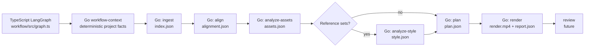

# auto-editor

`auto-editor` is a Go-first CLI for an agentic video-editing system. It currently initializes projects, validates and indexes inputs, aligns a voiceover transcript to its script, and analyzes visual assets.

## Workflow architecture

TypeScript owns workflow routing through the official
[`@langchain/langgraph`](https://www.npmjs.com/package/@langchain/langgraph)
package. The LangGraph state machine lives in `workflow/src/graph.ts` and treats
the Go CLI as its tool boundary. Go retains all deterministic domain systems:
input validation, media probing, hashing, transcription/alignment, artifact
analysis, planning constraints, rendering, and artifact writes.



LangGraph is used for all node execution and edges, including the conditional
style-analysis branch. It invokes `auto-editor workflow-context --json` to read
the reference-set fact, then runs each selected Go stage as a separate tool
process. The Go command does not contain pipeline routing or a `run` command.

## Future: semantic-analysis providers

Asset semantic analysis is designed behind a provider-neutral interface. The default configuration uses the OpenAI vision provider when an API key is available; pass `--no-semantic` to skip it for a single analysis run.

## Everyday workflow

Run commands from a project directory and the CLI discovers the nearest `auto-editor.json`, so standard artifact paths do not need to be repeated:

```powershell
auto-editor ingest
auto-editor align
auto-editor analyze-assets
auto-editor plan
```

Install the TypeScript workflow dependencies once:

```powershell
npm install
```

Run the LangGraph workflow through planning:

```powershell
npm run workflow -- --project C:\path\to\project --through plan
```

It runs Go's ingest, alignment, and asset-analysis tools; it invokes style
analysis only when Go reports reference sets. Use `auto-editor status` to see
which standard artifacts exist and the next suggested command.

For repeatable Windows integration checks, use the bundled PowerShell runner. It builds the CLI executable, runs `status`, executes the pipeline, then prints `status` again:

```powershell
& C:\Users\dev\tools\auto-editor\scripts\integration-test.ps1 -Project C:\Users\dev\tools\test\auto-test\test-1
```

The script builds the Go CLI, then asks the TypeScript LangGraph workflow to run
the complete pipeline through rendering.

Future work should add adapters for additional vision-capable providers, such as Claude, Gemini, and local models. Every adapter should return the same structured asset analysis—summary, subjects, actions, settings, mood, and visible text—so planning and rendering stay independent of the chosen model provider.

Each provider should be configured with an explicit provider name, model name, and API-key environment variable. Deterministic asset inspection must remain available without any external provider or API key.

## Asset-analysis output

Visual asset analysis separates two concepts:

- `literal`: evidence visible in the asset, such as subjects, actions, setting, mood, and on-screen text.
- `editorial_meaning`: an interpretation of the asset's likely reaction, joke, emotional beat, and useful editing roles.

Video semantic analysis uses start, middle, and end sample frames in one provider request. This gives the model sequence context while avoiding the added services and cost of audio transcription or full-video OCR.

## Semantic AI communication

When `assets.semantic_provider` is `openai`, the semantic provider uses a small, resilient communication layer:

- It sends the start/middle/end frames together as one asset-level request, so the model can infer sequence and meme context without three separate calls.
- It requests concise, schema-constrained JSON for `literal` and `editorial_meaning`; downstream stages receive predictable fields instead of fragile prose parsing.
- It caches successful results in `.auto-editor/semantic-cache.json`. The cache key includes the ordered frame bytes, selected model, image-detail setting, and semantic prompt revision, so unchanged assets do not consume another API request while changed frames or prompts are reanalyzed.
- It uses `store: false`, a bounded request timeout, and up to three attempts for provider-declared transient failures (429, 408, and 5xx), respecting `Retry-After` when supplied. It does not retry validation or authentication failures.

The user-editable settings below trade cost against fidelity. `auto` is the default because it is the documented default for OpenAI image inputs; use `low` for inexpensive broad triage or `high` for difficult visual detail.

```json
{
  "assets": {
    "semantic_provider": "openai",
    "semantic_model": "gpt-4o-mini",
    "api_key_environment": "OPENAI_API_KEY",
    "semantic_cache": true,
    "semantic_image_detail": "auto",
    "semantic_max_attempts": 3,
    "semantic_timeout_seconds": 60
  }
}
```

## Reference-video style analysis

`analyze-style` reads the named reference sets from the ingest index and writes `.auto-editor/style.json`. It always measures auditable style facts: reference-video count, total and median duration, aspect-ratio distribution, audio prevalence, scene-cut count, cuts per minute, and median shot duration. Each reference video retains its detected cut timestamps as evidence.

A semantic second pass can analyze a bounded, round-robin sample of reference frames for each named set. It returns a separate `semantic_style` object with caption conventions, humor patterns, emotional pacing, visual roles, editing techniques, planning preferences, supporting frame IDs, and confidence. The pass reuses the same OpenAI transport, bounded retry policy, `store: false` behavior, image-detail setting, and content-hash cache strategy as asset semantic analysis. Its cache is `.auto-editor/style-semantic-cache.json`. Pass `--no-semantic` to skip this pass for one run.

The default cap of 12 frames balances set-level coverage against cost; the cap is shared round-robin across videos so a large set does not let one reference dominate the interpretation.

```json
{
  "style": {
    "semantic_provider": "openai",
    "semantic_model": "gpt-4o-mini",
    "api_key_environment": "OPENAI_API_KEY",
    "semantic_cache": true,
    "semantic_image_detail": "auto",
    "semantic_max_frames": 12,
    "semantic_max_attempts": 3,
    "semantic_timeout_seconds": 60
  }
}
```

If the key, provider, or semantic pass is unavailable, deterministic style analysis still succeeds and records that the semantic portion was skipped or failed.

## Planning

`plan` combines `alignment.json` and `assets.json` into `.auto-editor/plan.json`. By default, a bounded semantic planning pass turns the word-timed narration into two to six coherent visual beats and selects an existing asset ID for each beat. It uses narration topic/scene/action/emotion changes, asset literal and editorial metadata, and optional reference-style preferences. The output is constrained and verified: every transcript word must be covered exactly once, and no asset ID can be invented. If the provider is unavailable or returns an invalid timeline, planning records a warning and falls back to the deterministic one-visual-per-alignment-segment behavior.

Use `auto-editor plan --no-semantic` to force that deterministic fallback for one run. Pass `--no-semantic` to the TypeScript workflow to disable semantic asset analysis, style analysis, and planning together.

Pass `--all-assets` to require every eligible visual asset to appear at least once:

```powershell
auto-editor plan --all-assets
npm run workflow -- --project C:\path\to\project --through render --all-assets
```

If the semantic response omits an asset, the planner uses a deterministic word-range split to satisfy the constraint. If there are more assets than transcript words, planning fails with an actionable error.

Use `--all-viewable-assets` to require every image and video, or `--all-audio-assets` to include every audio asset other than the voiceover as timed sound-effect cues. `--all-assets` combines both requirements.

When `style.json` contains completed semantic `planning_preferences`, the planner applies them only as soft ranking inputs. It deterministically compares meaningful preference terms with completed literal/editorial asset metadata, weights matches by the reference set's semantic confidence, and uses original asset order to break ties. Preferences never remove an asset, invent an ID, alter narration timing, or override source-duration limits. The version 5 plan artifact records source hashes, semantic beat choices and rationales, an explicit `hold_last_frame` policy when a short video must fill a longer planned slot, and optional background-music tracks.

Explicit-path command variants remain available when artifacts live outside the standard project location:

```powershell
auto-editor analyze-assets --index .auto-editor/index.json --config auto-editor.config.json --out .auto-editor/assets.json
auto-editor analyze-style --index .auto-editor/index.json --config auto-editor.config.json --out .auto-editor/style.json
auto-editor plan --index .auto-editor/index.json --assets .auto-editor/assets.json --style .auto-editor/style.json --out .auto-editor/plan.json --aspect 16:9
```

`analyze-style` requires at least one reference-video set. The LangGraph workflow skips its style node when Go's `workflow-context` tool reports no references; the planner then uses deterministic asset order.

## Rendering

`render` turns the current plan into a deterministic H.264/AAC MP4. It verifies the voiceover, selected visuals, and optional music against the hashes recorded in the plan before invoking FFmpeg, so changed media requires the relevant upstream stages to run again. Images are held for their planned duration; a video that is shorter than its planned slot freezes on its final frame. Background music is mixed beneath the voiceover with configurable volume, fades, and optional side-chain ducking.

Provide music during initialization (the flag may be repeated), or add paths under `inputs.music` in `auto-editor.json`:

```powershell
auto-editor init --name launch-video --script script.txt --voiceover voiceover.wav --asset assets --music music/background.mp3
npm run workflow -- --project C:\path\to\project --through render
```

The related settings are `render.music_volume_db` (default `-18`), `render.music_fade_in_ms`/`render.music_fade_out_ms` (default `500`), `render.music_ducking` (default `true`), and `render.music_duck_ratio` (default `8`).

```powershell
auto-editor render --out output/render.mp4
auto-editor render --no-captions
npm run workflow -- --project C:\path\to\project --through render
```

Rendering refuses to replace an existing final file unless `--force` is supplied. It writes `.auto-editor/render-report.json` with the plan hash, verified source hashes, effective settings, output media facts, and any final-frame hold warnings. FFmpeg and ffprobe must be available on `PATH`, or configured under `render` in `auto-editor.config.json`.

## Exporting an editable project

`export-project` writes an XML interchange timeline using the FCPXML 1.9 schema plus a portable project
package. The package contains `auto-editor.xml`, `manifest.json`, an import
guide, and copied source media under `assets/` by default:

```powershell
auto-editor export-project --out output/project
auto-editor export-project --link-assets --out output/project
auto-editor export-project --kdenlive --out output/kdenlive-project
```

Import `auto-editor.xml` through the target editor's XML import workflow. If
media is offline, relink it to the package's `assets/` directory (or to the
original paths when using `--link-assets`).
Use `--kdenlive` to write `auto-editor.kdenlive`, a Kdenlive MLT project.
